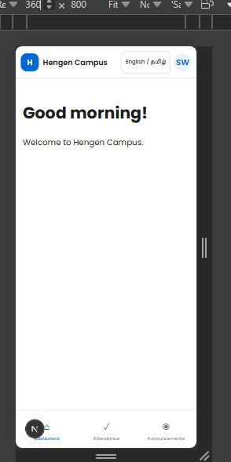
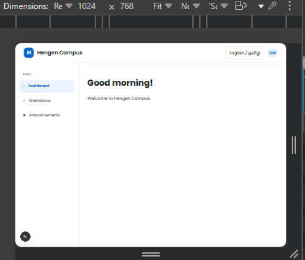

# Hengen Campus – Frontend

## 1. Project Overview

Hengen Campus is a mobile-first campus management web application built using Next.js. It provides a role-based interface for principals, accountants, teachers, and super administrators.

**Module:** M0 – App Shell, Routing and API Client
**Developer:** Swetha R.
**Technology:** Next.js, React, TypeScript

## 2. Technology Stack

- Next.js – App Router
- React
- TypeScript
- TanStack Query – Server state management
- MSW – API mocking
- Vitest – Unit testing
- React Testing Library – Component testing
- ESLint – Code quality

## 3. Project Structure

```text
src/
├── app/
│   ├── (school)/
│   │   ├── dashboard/
│   │   ├── attendance/
│   │   ├── announcements/
│   │   ├── fees/
│   │   ├── schools/
│   │   ├── settings/
│   │   └── users/
│   ├── login/
│   ├── 403/
│   ├── 404/
│   ├── not-found.tsx
│   └── providers.tsx
├── components/
│   ├── layout/
│   │   └── app-shell.tsx
│   └── ui/
│       ├── empty-state.tsx
│       ├── error-state.tsx
│       └── skeleton.tsx
├── lib/
│   ├── api-client.ts
│   ├── auth.ts
│   └── permission.ts
├── mocks/
│   ├── browser.ts
│   └── handlers.ts
└── test/
    └── setup.ts
```

## 4. Implemented Features

### Application Shell
- Responsive application layout.
- Header, sidebar and bottom navigation.
- Mobile-first layout.
- Navigation changes based on user role.

### Role-Based Navigation

| Role | Accessible sections |
|---|---|
| Principal | Dashboard, Attendance, Announcements, Fees |
| Accountant | Dashboard, Fees |
| Teacher | Dashboard, Attendance, Announcements |
| Super Admin | Dashboard, Schools, Users, Settings |

### Routing and Access Control
- Next.js App Router.
- Login page with return-to destination support.
- Role-based route permission checks.
- 403 – Access denied page.
- 404 – Page not found page.
- Authentication failure redirects to login.

### API Client
- Configurable API base URL.
- Authorization header support.
- Idempotency-Key for write requests.
- Typed API error handling.
- One access-token refresh attempt after a 401 response.
- Clears the access token when refresh fails or the retry remains unauthorized.

### Mock Service Worker
- Mock API handlers for `/me` and `/auth/refresh`.
- Mock announcements endpoint.
- Scenario support:
  - `slow` – Simulates a delayed response.
  - `error` – Simulates a server error.
  - `empty` – Returns an empty announcements list.

### Reusable UI Components
- Skeleton loading component.
- Empty state component.
- Error state component with retry support.

## 5. Installation and Setup

### Prerequisites
- Node.js
- npm
- Visual Studio Code (recommended)

### Install dependencies

```bash
npm install
```

### Environment configuration

Create or update `.env.local`:

```env
NEXT_PUBLIC_API_BASE_URL=http://localhost:4000
```

### Start development server

```bash
npm run dev
```

Open:

http://localhost:3000

## 6. Testing and Quality Checks

Run unit tests:

```bash
npm run test
```

Run lint:

```bash
npm run lint
```

Run TypeScript validation:

```bash
npm run typecheck
```

Create production build:

```bash
npm run build
```

### Current Test Coverage

- Role-based route permission tests.
- Empty state rendering test.
- Error state rendering test.
- Retry button interaction test.
- Skeleton rendering test.
- Custom skeleton dimensions test.

**Current result:** 11 tests passing across 2 test files.

## 7. Screenshots

### Mobile View – 360px



### Desktop View – 1024px




## 8. Development Notes

- The frontend currently uses Mock Service Worker for mock API responses.
- The login interface supports a return-to destination; production login integration depends on the backend authentication contract.
- Mock authentication uses the configured mock API handlers.
- API integration should follow the agreed backend contract.

## 9. Developer

**Developed by:** Swetha R.
**Module:** Frontend – M0
**Project:** Hengen Campus
